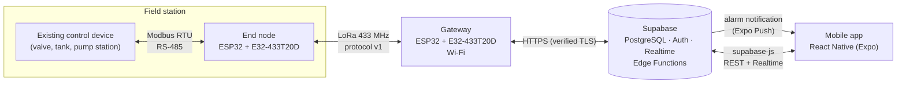

# Development of a LoRaWAN-Based Mobile Water Management System

[Türkçe](README.md) · **English**

[](https://github.com/hilllalllk/lora-water-management/actions/workflows/ci.yml)
[](LICENSE)

An infrastructure that **reads data from and writes commands to the digital control devices already installed** at valves, water tanks and pump stations **over LoRa**, managed from a **mobile app**. Developed as a graduation project.

- **Bidirectional:** level, valve state, pressure, flow and alarms are read from the field; valve open/close commands are sent from the app.
- **Device-independent:** the field device sits behind an adapter interface. Ready adapters: a simulated device and **Modbus RTU (RS-485)**. A different device only needs a new adapter or register map.
- **Reliable:** our own LoRa protocol has a CRC, sequence numbers, acknowledgements (ACK) and retransmission.
- **Manageable:** user roles (admin, operator, viewer), history charts, alarm thresholds and push notifications.
- **Tested:** the protocol (C++ and TypeScript against the same test vectors), the Modbus layer, the database access rules and the mobile app are tested by CI on every push.

> **Note:** the project does not use a LoRaWAN network server; it uses **plain LoRa** with Ebyte E32 modules. Rationale: [ADR-0001](docs/adr/0001-duz-lora.md) (Turkish).

## Architecture



**Read path:** control device → node → `TELEMETRY` → gateway → `telemetry` table → trigger updates `devices` and checks thresholds → the app sees it live and gets a notification when a threshold is crossed.
**Write path:** an operator sends a command → a `pending` row in `commands` → the gateway polls every 1-2 s → `COMMAND` → the node writes it to the device over Modbus → `CMD_RESULT` → `done`.

Details (Turkish): [Technology decisions](docs/09-teknoloji-kararlari.md) · [System architecture](docs/02-sistem-mimarisi.md) · [LoRa protocol](docs/03-protokol.md)

## Repository layout

```
lora-water-management/
├── docs/                  # documentation (Turkish), see the table below
├── firmware/              # C++ / PlatformIO: end node, gateway, protocol and Modbus libraries, tests
├── backend/supabase/      # SQL: schema, RLS, roles, alarms, tests + Edge Function (TypeScript)
├── mobile/                # TypeScript / React Native (Expo) app
├── tools/                 # TypeScript: second protocol implementation and frame decoder
├── hardware/              # bill of materials, schematics
├── scripts/               # creates GitHub issues and the project board
└── .github/               # CI, issue and PR templates
```

## Quick start

Step-by-step guide (Turkish, Windows included): **[docs/05-kurulum.md](docs/05-kurulum.md)**

```bash
git clone https://github.com/hilllalllk/lora-water-management.git
cd lora-water-management

# 1) Supabase: run backend/supabase/migrations/*.sql in order in the SQL Editor
# 2) Firmware (VS Code + PlatformIO)
cd firmware
pio test -e native                    # protocol and Modbus tests
pio run -e node -t upload             # end node (simulated device)
cp include/secrets.example.h include/secrets.h   # fill in Wi-Fi and Supabase settings
pio run -e gateway -t upload          # gateway
# 3) Mobile
cd ../mobile && npm install && cp .env.example .env.local && npx expo start
```

## Documentation (Turkish)

| # | Document | Content |
|---|---|---|
| 00 | [Project summary](docs/00-proje-ozeti.md) | Goal and scope |
| 01 | [Architecture research](docs/01-mimari-arastirmasi.md) | Similar projects, LoRa vs. LoRaWAN |
| 02 | [System architecture](docs/02-sistem-mimarisi.md) | Layers, data model, development phases |
| 03 | [LoRa protocol](docs/03-protokol.md) | Byte-level definition and examples |
| 04 | [Hardware](docs/04-donanim.md) | Bill of materials, wiring, legal power limit |
| 05 | [Setup guide](docs/05-kurulum.md) | From zero to a running system (Windows included) |
| 06 | [Test plan](docs/06-test-plani.md) | Acceptance tests and results |
| 07 | [Development log](docs/07-gelistirme-gunlugu.md) | Progress log |
| 08 | [Security](docs/08-guvenlik.md) | Protections and known gaps |
| 09 | [Technology decisions](docs/09-teknoloji-kararlari.md) | Every choice and its rationale |
| — | [Architecture decisions](docs/adr/README.md) | ADR records |

## Development phases

Work is tracked in a GitHub Projects board and issues. To create them: `bash scripts/github-issues.sh`.

| Phase | Work | Status |
|---|---|---|
| — | Research, architecture, protocol design, repository | ✅ |
| A1 | Fixed-address transmission between two ESP32 + E32 | ⬜ |
| A2 | Protocol v1 (CRC, ACK, retry) on hardware | ⬜ (code + unit tests ready) |
| A3 | Field device adapters (simulated + Modbus RTU) | ⬜ (code + unit tests ready) |
| A4 | Gateway → Supabase | ⬜ (code ready) |
| A5 | Supabase → gateway → node commands | ⬜ (code ready) |
| A6 | Mobile app (roles, charts, alarms, thresholds) | ⬜ (code ready) |
| A7 | Field / range test | ⬜ |
| A8 | Real control device integration | ⬜ (register map from advisor) |

## Technologies and languages

| Component | Hardware / platform | Language |
|---|---|---|
| End node | ESP32 DevKit V1 + Ebyte E32-433T20D | C++ (Arduino, PlatformIO) |
| Field device link | MAX3485 (RS-485), Modbus RTU | C++ |
| Gateway | ESP32 DevKit V1 + E32-433T20D, Wi-Fi | C++ (Arduino, PlatformIO) |
| Server | Supabase free plan, Frankfurt | SQL + TypeScript (Edge Function) |
| Mobile app | Android (APK) and iOS (Expo Go) | TypeScript (React Native, Expo) |
| Tools | frame decoder (`npm run frame`) | TypeScript |

Language rule: the README is bilingual, detailed documents are in Turkish, code comments are in English, and the app UI is in Turkish ([ADR-0006](docs/adr/0006-bilesen-dilleri.md)).

## Team

| Name | Role | GitHub |
|---|---|---|
| Kadir Berke | | |
| | | |

Advisor: Erkan Duman

## License

[MIT](LICENSE)
