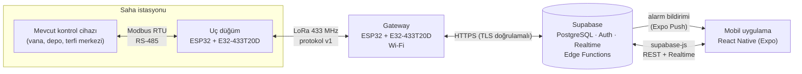

# LoRaWAN Tabanlı Mobil Su Yönetim Sisteminin Geliştirilmesi

**Türkçe** · [English](README.en.md)

[](https://github.com/hilllalllk/lora-water-management/actions/workflows/ci.yml)
[](LICENSE)

Vanalarda, depolarda ve terfi merkezlerinde zaten bulunan **dijital kontrol cihazlarından LoRa ile veri okuyan ve onlara komut yazan**, bunu da **mobil uygulamadan** yöneten bir altyapı. Bitirme projesi olarak geliştirilmektedir.

- **Çift yönlü:** Sahadan seviye, vana durumu, basınç, debi ve alarm okunur; uygulamadan vana aç/kapat komutu gönderilir.
- **Cihazdan bağımsız:** Saha cihazı bir adaptör arayüzünün arkasındadır. Hazır adaptörler: simüle cihaz ve **Modbus RTU (RS-485)**. Cihaz değişince sadece adaptör ya da register haritası değişir.
- **Güvenilir:** Kendi LoRa protokolümüz CRC, sıra numarası, onay (ACK) ve yeniden gönderim içerir.
- **Yönetilebilir:** Kullanıcı rolleri (yönetici, operatör, izleyici), geçmiş grafikleri, eşik ayarları ve telefona alarm bildirimi.
- **Test edilmiş:** Protokol (C++ ve TypeScript aynı test vektörleriyle), Modbus katmanı, veritabanı yetki kuralları ve mobil uygulama her gönderimde CI ile test edilir.

> **Not:** Proje LoRaWAN ağ sunucusu değil, Ebyte E32 modülleriyle **düz LoRa** kullanır. Gerekçe: [ADR-0001](docs/adr/0001-duz-lora.md).

## Mimari



**Okuma:** kontrol cihazı → düğüm → `TELEMETRY` → gateway → `telemetry` tablosu → tetikleyici `devices`'ı günceller ve eşikleri kontrol eder → uygulama canlı görür, eşik aşılırsa bildirim gelir.
**Yazma:** operatör uygulamadan komut verir → `commands`'a `pending` eklenir → gateway 1-2 saniyede bir sorgular → `COMMAND` → düğüm cihaza Modbus ile yazar → `CMD_RESULT` → `done`.

Ayrıntılar: [Teknoloji ve Donanım Kararları](docs/09-teknoloji-kararlari.md) · [Sistem Mimarisi](docs/02-sistem-mimarisi.md) · [LoRa Protokolü](docs/03-protokol.md)

## Repo yapısı

```
lora-water-management/
├── docs/                  # tüm dokümantasyon (aşağıdaki tabloya bakın)
├── firmware/              # C++ / PlatformIO: uç düğüm, gateway, protokol ve Modbus kütüphaneleri, testler
├── backend/supabase/      # SQL: şema, RLS, roller, alarmlar, testler + Edge Function (TypeScript)
├── mobile/                # TypeScript / React Native (Expo) uygulaması
├── tools/                 # TypeScript: protokolün ikinci uygulaması ve çerçeve çözücü
├── hardware/              # malzeme listesi, devre çizimleri
├── scripts/               # GitHub issue ve proje panosu oluşturma betiği
└── .github/               # CI, issue ve PR şablonları
```

## Hızlı başlangıç

Adım adım rehber (Windows dahil): **[docs/05-kurulum.md](docs/05-kurulum.md)**

```bash
git clone https://github.com/hilllalllk/lora-water-management.git
cd lora-water-management

# 1) Supabase: backend/supabase/migrations/*.sql dosyalarını sırayla SQL Editor'de çalıştırın
# 2) Firmware (VS Code + PlatformIO)
cd firmware
pio test -e native                    # protokol ve Modbus testleri
pio run -e node -t upload             # uç düğüm (simüle cihaz)
cp include/secrets.example.h include/secrets.h   # Wi-Fi ve Supabase bilgilerini doldurun
pio run -e gateway -t upload          # gateway
# 3) Mobil
cd ../mobile && npm install && cp .env.example .env.local && npx expo start
```

## Dokümantasyon

| # | Doküman | İçerik |
|---|---|---|
| 00 | [Proje Özeti](docs/00-proje-ozeti.md) | Amaç ve kapsam |
| 01 | [Mimari Araştırması](docs/01-mimari-arastirmasi.md) | Benzer projeler, LoRa ve LoRaWAN karşılaştırması |
| 02 | [Sistem Mimarisi](docs/02-sistem-mimarisi.md) | Katmanlar, veri modeli, geliştirme aşamaları |
| 03 | [LoRa Protokolü](docs/03-protokol.md) | Bayt düzeyinde tanım ve örnekler |
| 04 | [Donanım](docs/04-donanim.md) | Malzeme listesi, bağlantı şemaları, yasal güç sınırı |
| 05 | [Kurulum Rehberi](docs/05-kurulum.md) | Sıfırdan çalışan sisteme (Windows dahil) |
| 06 | [Test Planı](docs/06-test-plani.md) | Kabul testleri ve sonuçlar |
| 07 | [Geliştirme Günlüğü](docs/07-gelistirme-gunlugu.md) | İlerleme kaydı |
| 08 | [Güvenlik](docs/08-guvenlik.md) | Korumalar ve bilinen açıklar |
| 09 | [Teknoloji ve Donanım Kararları](docs/09-teknoloji-kararlari.md) | Bütün seçimler ve gerekçeleri |
| — | [Mimari Kararlar](docs/adr/README.md) | ADR kayıtları |

## Geliştirme aşamaları

İşler GitHub Projects panosunda ve issue'larda takip edilir. Panoyu ve issue'ları oluşturmak için: `bash scripts/github-issues.sh`.

| Aşama | İş | Durum |
|---|---|---|
| — | Araştırma, mimari, protokol tasarımı, repo | ✅ |
| A1 | İki ESP32 + E32 ile sabit adresli gönderim | ⬜ |
| A2 | Protokol v1 (CRC, ACK, tekrar) kartta | ⬜ (kod + birim testleri hazır) |
| A3 | Saha cihazı adaptörleri (simüle + Modbus RTU) | ⬜ (kod + birim testleri hazır) |
| A4 | Gateway → Supabase | ⬜ (kod hazır) |
| A5 | Supabase → gateway → düğüm komutları | ⬜ (kod hazır) |
| A6 | Mobil uygulama (roller, grafik, alarm, eşikler) | ⬜ (kod hazır) |
| A7 | Saha / menzil testi | ⬜ |
| A8 | Gerçek kontrol cihazı entegrasyonu | ⬜ (register haritası danışmandan) |

## Teknolojiler ve diller

| Bileşen | Donanım / platform | Dil |
|---|---|---|
| Uç düğüm | ESP32 DevKit V1 + Ebyte E32-433T20D | C++ (Arduino, PlatformIO) |
| Saha cihazı bağlantısı | MAX3485 (RS-485), Modbus RTU | C++ |
| Gateway | ESP32 DevKit V1 + E32-433T20D, Wi-Fi | C++ (Arduino, PlatformIO) |
| Sunucu | Supabase ücretsiz plan, Frankfurt | SQL + TypeScript (Edge Function) |
| Mobil uygulama | Android (APK) ve iOS (Expo Go) | TypeScript (React Native, Expo) |
| Araçlar | çerçeve çözücü (`npm run frame`) | TypeScript |

Dil kuralı: README iki dillidir, ayrıntılı dokümanlar Türkçedir, kod yorumları İngilizcedir, uygulama arayüzü Türkçedir ([ADR-0006](docs/adr/0006-bilesen-dilleri.md)).


