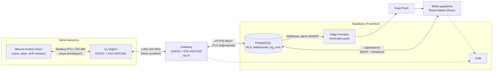
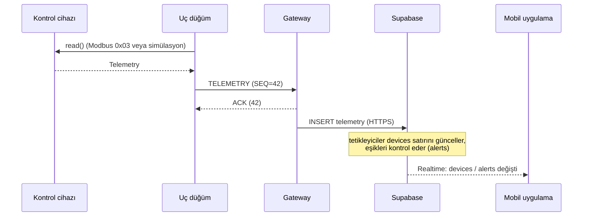
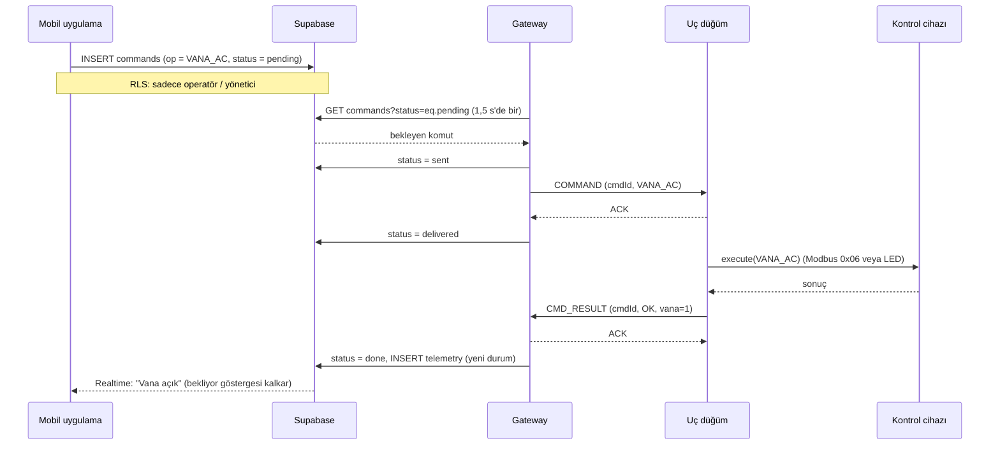
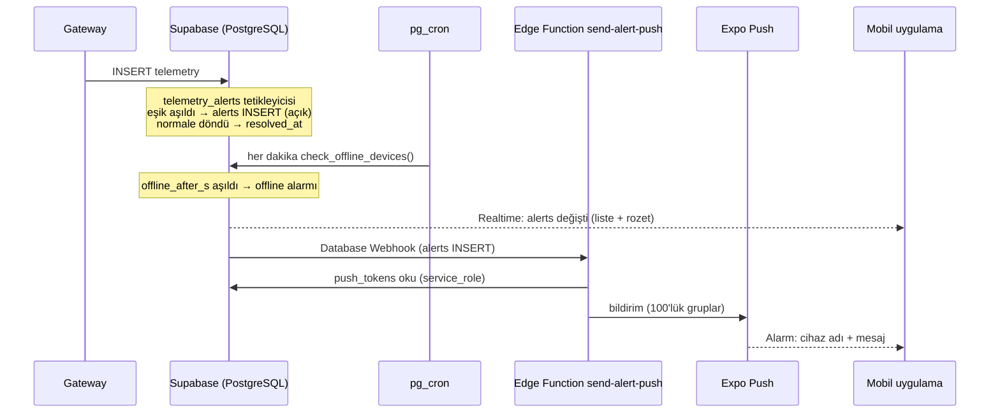

# 02 · Sistem Mimarisi

> Bitirme projesi: **LoRaWAN Tabanlı Mobil Su Yönetim Sisteminin Geliştirilmesi**
> Adım 2 çıktısı · 14 Ekim 2026 · Durum: **v0.4** (18.10.2026: gateway yeniden ESP32, E32-433T20D, Modbus RTU adaptörü, roller ve alarmlar)
> Önceki adım: [01 · Mimari Araştırması](01-mimari-arastirmasi.md) · Kararların tamamı: [09 · Teknoloji ve Donanım Kararları](09-teknoloji-kararlari.md)

## 0. Alınan kararlar

| # | Karar | Gerekçe |
|---|---|---|
| K1 | Radyo katmanı **düz LoRa**: Ebyte **E32-433T20D** (100 mW), ağ sunucusu yok ([ADR-0001](adr/0001-duz-lora.md)) | Komut sayısında sınır yok; T20D en düşük kademede ≈ 10 mW'a inebiliyor |
| K2 | Uç düğüm ve gateway aynı donanım: **ESP32 DevKit V1 + E32-433T20D**, C++ (Arduino, PlatformIO) ([ADR-0007](adr/0007-gateway-yeniden-esp32.md)) | Tek platform, tek araç zinciri, ek donanım yok |
| K3 | Adresleme, onay (ACK) ve komut protokolü **bizim tarafımızdan** tanımlanır (§4, [ADR-0004](adr/0004-kendi-protokolumuz.md)) | LoRaWAN'ın hazır verdiği işlevleri karşılamak için |
| K4 | Saha cihazı bir **adaptör arayüzü** arkasındadır: `SimulatedDevice` ve `ModbusRtuDevice` ([ADR-0008](adr/0008-saha-cihazi-modbus.md)) | Danışman: kontrol cihazları sahada var, iletişim kurulacak cihaz kısmı esnek |
| K5 | Sunucu: **Supabase** ücretsiz plan, Frankfurt (eu-central-1) ([ADR-0002](adr/0002-supabase.md)) | İlişkisel tablolar, RLS, Realtime, Edge Functions, pg_cron |
| K6 | Mobil: **React Native (Expo) + TypeScript** + `supabase-js`; Android APK (EAS), iPhone'da Expo Go | Windows'ta geliştirilebilir, iki platformda gösterilebilir |
| K7 | Düğümler USB adaptörle beslenir, radyo **sürekli dinlemede** (E32 mod 0) | Vana komutunun gecikmesiz ulaşması için |
| K8 | Gateway bekleyen komutları **REST ile 1,5 s'de bir sorgular** ([ADR-0003](adr/0003-gateway-rest-sorgulama.md)) | ESP32 için Supabase Realtime kütüphaneleri olgun değil |
| K9 | Kullanıcı rolleri (yönetici, operatör, izleyici), eşik tabanlı alarmlar ve push bildirimi veritabanında tanımlıdır (§6.2, §6.3) | Yetki kuralları istemciye değil RLS'ye dayanır |

---

## 1. Genel görünüm



Tek gateway, birden fazla uç düğüm (yıldız topoloji). Gateway veriyi **yorumlamaz**: LoRa paketini çözüp Supabase'e yazar, Supabase'deki komutları LoRa paketine çevirir. Eşik kontrolü ve alarmlar veritabanında yapılır.

---

## 2. Katmanlar ve sorumluluklar

| Katman | Nerede çalışır | Sorumluluk | Bilmediği şey |
|---|---|---|---|
| **Saha cihazı adaptörü** | Uç düğüm (`lib/FieldDevice`) | Cihazdan veri okumak, cihaza komut uygulamak (simülasyon veya Modbus RTU) | LoRa'yı, Supabase'i |
| **Modbus RTU kütüphanesi** | Uç düğüm (`lib/ModbusRtu`) | CRC, 0x03 / 0x06 çerçeveleri; donanımdan bağımsız | Register'ların anlamı |
| **Düğüm uygulaması** | Uç düğüm (`src/node`) | Periyodik / olay bazlı telemetri, komutu adaptöre iletmek | Cihazın iç detayı |
| **Bağlantı protokolü** (§4) | Düğüm + gateway (`lib/LoraProtocol`) | Çerçeveleme, CRC, sıra no, ACK, tekrar deneme | Verinin anlamı |
| **E32 sürücüsü** | Düğüm + gateway (`lib/E32Radio`) | M0/M1/AUX yönetimi, yapılandırma, sabit adresli gönderim | Protokolün içeriği |
| **Gateway uygulaması** | Gateway (`src/gateway`) | LoRa ⇄ Supabase dönüşümü, komut sorgulama, kendi sağlığı | Cihaz türü |
| **Veri katmanı** | Supabase | Son durum, komut kuyruğu, geçmiş, roller, eşikler, alarmlar | Radyo |
| **Bildirim** | Supabase Edge Function | Yeni alarmı Expo Push ile telefonlara göndermek | Radyo, cihaz |
| **Mobil uygulama** | Telefon | İzleme, grafik, alarm listesi, komut, eşik ve rol yönetimi | Radyo, cihaz protokolü |

### 2.1 Saha cihazı adaptörü (cihazdan bağımsızlık)

Kod: [`firmware/lib/FieldDevice/src/FieldDevice.h`](../firmware/lib/FieldDevice/src/FieldDevice.h). Düğüm yazılımı tek bir arayüzle konuşur; adaptör derleme ortamıyla seçilir.

| Adaptör | Ortam | Ne yapar |
|---|---|---|
| `SimulatedDevice` | `node` (0x1001), `node2` (0x1002) | LED (GPIO2) vana, potansiyometre (GPIO34) seviye |
| `ModbusRtuDevice` | `node-modbus` (0x1003, `-DFIELD_DEVICE_MODBUS`) | RS-485 (MAX3485, 9600 8N1, slave 1) üzerinden holding register okur/yazar |

Modbus eşlemesi ([`firmware/include/modbus_map.h`](../firmware/include/modbus_map.h), **yer tutucu harita**; gerçek cihazın register listesiyle değiştirilecek):

| LoRa tarafı | Modbus işlemi |
|---|---|
| Telemetri / `SIMDI_OKU` | 0x03 ile register 0–4: seviye (mm), vana durumu, basınç (cbar), debi (dL/dk), alarm bitleri |
| `VANA_AC` / `VANA_KAPAT` | Vana durumu okunur; zaten o durumdaysa `ALREADY_IN_STATE`, değilse 0x06 ile register 10 = 1 / 0 |
| `CIHAZ_ETKIN` | 0x06 ile register 11 = 1 / 0; devre dışıyken vana komutları reddedilir |
| `PERIYOT_AYARLA` | Düğümün kendisi uygular, hatta trafik yok |

Zaman aşımı, CRC hatası veya istisna cevabı komutta `DEVICE_ERROR`, telemetride `SensorFault` alarm bitini verir. Yeni bir cihaz türü (4–20 mA, röle) için `FieldDevice` arayüzünü uygulayan yeni bir sınıf yazılır; protokol, gateway, veritabanı ve uygulama değişmez.

---

## 3. Donanım

> Malzeme listesi ve bağlantı şemaları: [04 · Donanım](04-donanim.md).

### 3.1 Bağlantılar (uç düğüm ve gateway)

Gateway ile uç düğümün E32 bağlantısı aynıdır. Pinler [`firmware/include/config.h`](../firmware/include/config.h) dosyasındadır.

| ESP32 pini | Bağlantı | Not |
|---|---|---|
| GPIO16 (UART2 RX) | E32 TXD | |
| GPIO17 (UART2 TX) | E32 RXD | |
| GPIO4 / GPIO5 | E32 M0 / M1 | Mod seçimi |
| GPIO18 | E32 AUX | LOW = modül meşgul |
| VIN (5 V, USB'den) + GND | E32 VCC + GND | T20D 3,3–5,2 V, iletimde ~130 mA; ayrı güç kaynağı gerekmez, modülün yanına 100 µF kondansatör |
| GPIO25 / GPIO26 | MAX3485 RO / DI | Sadece `node-modbus` (UART1) |
| GPIO27 | MAX3485 DE + /RE | HIGH = gönder |
| GPIO2 / GPIO34 | LED / potansiyometre | Sadece simüle cihaz |

### 3.2 E32 ayarları

Kaynak: Ebyte E32 kullanım kılavuzu ([PDF](https://atta.szlcsc.com/upload/public/pdf/source/20220808/3C7B3108BF1F7C528E0D6D2B18D3633E.pdf)), [xreef/LoRa_E32_Series_Library](https://github.com/xreef/LoRa_E32_Series_Library).

| Ayar | Değer | Açıklama |
|---|---|---|
| Çalışma modu | Mod 0 (M0=0, M1=0) | Normal gönder/al; mod 3 (M0=1, M1=1) sadece ayar için |
| İletim tipi | **Sabit (fixed)** | Her çerçevenin ilk 3 baytı: ADDH, ADDL, CHAN |
| Kanal | 0x17 → 433 MHz | Frekans = 410 MHz + CHAN × 1 MHz |
| Hava hızı | 2,4 kbps | İki uç aynı olmalı |
| Paket boyu | ≤ 58 bayt | Protokol çerçeveleri 58 baytın altında |
| FEC | Açık | |
| Çıkış gücü | **En düşük kademe** (`E32Power::Min` = 10 dBm ≈ 10 mW) | Kademeler 20 / 17 / 14 / 10 dBm (bkz. §8) |

Firmware açılışta modülü kendisi yapılandırır (düğüm ve gateway).

### 3.3 Adres planı

| Cihaz | ADDH:ADDL | Not |
|---|---|---|
| Gateway | `0x00:0x01` | |
| Uç düğümler | `0x10:0x01` … `0x10:0xFE` | `node` 0x1001, `node2` 0x1002, `node-modbus` 0x1003 |
| Yayın | `0xFF:0xFF` | v1'de kullanılmıyor |

---

## 4. LoRa bağlantı protokolü (v1)

> Bayt düzeyindeki tam tanım ve örnekler: [03 · LoRa Protokolü](03-protokol.md). Kod: [`firmware/lib/LoraProtocol`](../firmware/lib/LoraProtocol/src/LoraProtocol.h).

LoRaWAN'da hazır gelen kimlik, sıra numarası, onay ve bütünlük kontrolünü küçük bir ikili protokolle karşılıyoruz.

### 4.1 Çerçeve yapısı

```
 E32 sabit başlığı (modül tüketir)     Bizim çerçevemiz (≤ 55 bayt)
┌──────┬──────┬──────┐┌─────┬──────┬────────┬─────┬─────┬───────────────┬────────┐
│ ADDH │ ADDL │ CHAN ││ VER │ TYPE │ SRC(2) │ SEQ │ LEN │ PAYLOAD (≤47) │ CRC16  │
└──────┴──────┴──────┘└─────┴──────┴────────┴─────┴─────┴───────────────┴────────┘
     hedef adres            1      1      2      1     1       LEN          2
```

| Alan | Boyut | Açıklama |
|---|---|---|
| VER | 1 | Protokol sürümü (`0x01`) |
| TYPE | 1 | Mesaj tipi (§4.2) |
| SRC | 2 | Gönderenin adresi (alıcı, cevabı nereye yollayacağını buradan bilir) |
| SEQ | 1 | Gönderen başına artan sıra no (0–255, döner). Tekrar eden paketi ayıklamak için |
| LEN | 1 | PAYLOAD uzunluğu |
| CRC16 | 2 | VER…PAYLOAD üzerinde CRC-16/CCITT-FALSE |

### 4.2 Mesaj tipleri

| TYPE | Ad | Yön | ACK ister mi | İçerik |
|---|---|---|---|---|
| `0x01` | TELEMETRY | Düğüm → GW | Evet | TLV ölçümler (§4.4) |
| `0x02` | HEARTBEAT | Düğüm → GW | Hayır | Çalışma süresi, firmware sürümü |
| `0x10` | COMMAND | GW → Düğüm | Evet | `cmdId(2) · opcode(1) · args` |
| `0x11` | CMD_RESULT | Düğüm → GW | Evet | `cmdId(2) · resultCode(1)` + yeni durum TLV |
| `0x7F` | ACK | İki yön | — | `ackSeq(1)` |

### 4.3 Komut kodları (opcode)

| Opcode | Komut | Argüman |
|---|---|---|
| `0x01` | VANA_AC | — |
| `0x02` | VANA_KAPAT | — |
| `0x03` | CIHAZ_ETKIN | `0/1` |
| `0x04` | SIMDI_OKU | — (anında TELEMETRY gönder) |
| `0x05` | PERIYOT_AYARLA | `saniye(2)` |

Sonuç kodları: `0x00` başarılı, `0x01` bilinmeyen komut, `0x02` cihaz hatası, `0x03` zaman aşımı, `0x04` zaten bu durumda.

### 4.4 Telemetri yükü: TLV (Tag-Length-Value)

Cihaz türü değiştiğinde çerçeve yapısı değişmesin diye ölçümler etiketli gönderilir. Bilinmeyen etiket alıcı tarafından atlanır.

| Tag | Ölçüm | Tip | Birim |
|---|---|---|---|
| `0x01` | Depo seviyesi | uint16 | mm |
| `0x02` | Vana durumu | uint8 | 0 kapalı · 1 açık · 2 hareket · 3 hata |
| `0x03` | Basınç | uint16 | centibar |
| `0x04` | Debi | uint16 | dL/dk |
| `0x05` | Alarm bayrakları | uint8 | bit0 taşma · bit1 kuru çalışma · bit2 sensör hatası |
| `0x06` | Besleme gerilimi | uint16 | mV |

Örnek: seviye 1250 mm, vana açık → `01 02 04E2  02 01 01` (7 bayt).

### 4.5 Güvenilirlik kuralları

- **Dur-ve-bekle ACK:** ACK isteyen bir mesajdan sonra 2 s içinde ACK gelmezse aynı SEQ ile tekrar gönderilir; en fazla 3 deneme. (2 s başlangıç değeridir, 2.4 kbps'de ölçülen gidiş-dönüş süresine göre ayarlanacak.)
- **Tekrar ayıklama:** Alıcı her gönderen için son SEQ'i saklar; aynı SEQ tekrar gelirse yeniden ACK gönderir ama işlemi **tekrarlamaz**.
- **Komutlar tekrar uygulanabilir (idempotent):** `cmdId` aynıysa düğüm komutu ikinci kez çalıştırmaz, önceki sonucu yeniden gönderir.
- **Çakışmayı azaltma:** Düğümler periyodik telemetriyi `periyot ± rastgele %20` sapmayla gönderir. Gönderimden önce AUX pininin HIGH olması beklenir.
- **Olay bazlı gönderim:** Vana durumu değişirse veya alarm oluşursa periyot beklenmeden TELEMETRY gönderilir.
- **Güvenlik (v2'ye bırakıldı):** E32 kılavuzunda şifreleme özelliği tanımlı değil, yani radyo trafiği düz metin. v2'de yüke AES-128 şifreleme ve 4 baytlık doğrulama etiketi (MIC) eklenebilir; çerçeve ≤ 58 bayt sınırında kalacak şekilde PAYLOAD sınırı buna göre düşürülür. Prototip için bu bilinçli bir kısıt olarak raporlanmalı.

### 4.6 Akışlar

**Okuma (saha → mobil)**



**Yazma (mobil → saha)**



Uygulama komut gönderince butonu **"bekliyor"** durumunda tutar ve gerçek durumu ancak düğüm `CMD_RESULT` gönderdikten sonra gösterir. 3 denemede ACK alınamazsa gateway `status = failed` yazar.

### 4.7 Alarm akışı



Aynı cihaz ve türde en fazla bir açık alarm olur; değer normale dönünce alarm kendiliğinden kapanır. Sessiz cihaz tekrar duyulduğunda (telemetri veya heartbeat) `offline` alarmı kapanır.

---

## 5. Gateway yazılımı

> Kod: [`firmware/src/gateway`](../firmware/src/gateway/main.cpp) (C++, PlatformIO ortamı `gateway`). Ayrıntı: [`firmware/README.md`](../firmware/README.md#gateway).

| Dosya | Görev |
|---|---|
| `main.cpp` | Wi-Fi, NTP, LoRa alıcı, komut sorgulama, ACK/tekrar zamanlayıcısı, sağlık kaydı |
| `SupabaseRest.h/.cpp` | Supabase Auth girişi ve token yenileme, PostgREST çağrıları (ArduinoJson) |
| `root_ca.h` | TLS kök sertifikaları: ISRG Root X1/X2, GTS Root R1/R4 (`setCACert`) |
| `include/secrets.h` | Wi-Fi ve Supabase bilgileri; `secrets.example.h`'den kopyalanır, Git'e girmez |

Görevleri:

1. **Açılış:** Wi-Fi'ye bağlanır, saati NTP ile ayarlar (TLS doğrulaması gerçek tarihe ihtiyaç duyar), E32'yi yapılandırır, `gateway` rolündeki kullanıcıyla Supabase'e giriş yapar.
2. **LoRa alıcı:** Çerçeve → CRC kontrol → tekrar ayıklama → ACK → `telemetry` satırı (HTTPS).
3. **Komut sorgulama:** `commands?status=eq.pending` her **1,5 s**'de bir sorgulanır; komut LoRa'ya çevrilir, durumu `sent → delivered → done/failed` olarak güncellenir.
4. **ACK / tekrar:** 2 s zaman aşımı, en fazla 3 deneme; sonra `failed` (TIMEOUT).
5. **Cihaz listesi:** `devices` (`id`, `address`) açılışta ve **5 dakikada bir** yenilenir.
6. **Düğüm görüldü:** HEARTBEAT gelince `devices.last_seen` ve `fw` güncellenir.
7. **Kendi sağlığı:** `gateways` satırı (`last_seen`, `fw`, `wifi_rssi`) **60 s**'de bir upsert edilir.

İnternet koparsa v1'de bu sırada gelen telemetri buluta yazılamaz (düğüme yine ACK verilir); kalıcı kuyruk v2'ye bırakıldı.

---

## 6. Supabase veri modeli

> Çalışan şema: [`20261014000000_init.sql`](../backend/supabase/migrations/20261014000000_init.sql) (tablolar, tetikleyiciler, RLS, Realtime) ve [`20261018000000_roles_alarms.sql`](../backend/supabase/migrations/20261018000000_roles_alarms.sql) (roller, eşikler, alarmlar, push token'ları). Bu bölüm özettir; farklılık olursa migration dosyaları geçerlidir.

### 6.1 Tablolar

| Tablo | İçerik | Yazan |
|---|---|---|
| `devices` | Düğümler, son durum (`level_mm`, `valve`, `pressure_cbar`, `flow_dl_min`, `alarms`, `last_seen`, `fw`, `period_s`) ve eşikler | Yönetici (ekleme, ad, eşikler), gateway (heartbeat), tetikleyici (son ölçüm) |
| `telemetry` | Ölçüm geçmişi (her TELEMETRY / CMD_RESULT bir satır) | Sadece gateway |
| `commands` | Komut kuyruğu: `op`, `args`, `status` (`pending`, `sent`, `delivered`, `done`, `failed`), `result`, `created_by` | Operatör/yönetici `pending` ekler, gateway durumu günceller |
| `gateways` | Gateway sağlığı: `fw`, `wifi_rssi`, `last_seen` | Sadece gateway |
| `profiles` | Kullanıcı başına bir satır: `full_name`, `email`, `role` | Tetikleyici (yeni kullanıcı), yönetici (rol), kullanıcı (kendi adı) |
| `alerts` | Alarm olayları: `kind`, `message` (Türkçe), `value`, `created_at`, `resolved_at` | Sadece tetikleyiciler ve `check_offline_devices()` |
| `push_tokens` | Telefonların Expo push token'ları: `token`, `user_id`, `platform` | Her kullanıcı kendi satırını (`register_push_token()`) |

`devices` eşik sütunları (boş = kontrol yok): `level_low_mm`, `level_high_mm`, `pressure_low_cbar`, `pressure_high_cbar`, `offline_after_s` (varsayılan 600, en az 60).

Tetikleyiciler:

| Ad | Ne yapar |
|---|---|
| `telemetry_apply` | Yeni telemetriyle `devices` son durumunu ve `last_seen`'i günceller |
| `telemetry_alerts` | Eşikleri ve alarm bitlerini kontrol eder, alarm açar / kapatır |
| `devices_resolve_offline` | Cihaz tekrar duyulunca `offline` alarmını kapatır |
| `on_auth_user_created` | Yeni kullanıcıya `viewer` rolüyle profil açar |
| `profiles_guard`, `devices_guard` | Rol ve eşik değişikliğini yöneticiye, durum sütunlarını gateway'e sınırlar; son yönetici düşürülemez |

`devices`, `commands` ve `alerts` Realtime yayınındadır; uygulama bunlara abone olur.

### 6.2 Roller ve yetki kuralları (Row Level Security)

| Rol | Yetki |
|---|---|
| `admin` (Yönetici) | Operatörün her şeyi + kullanıcı rolleri ve cihaz eşikleri |
| `operator` (Operatör) | Komut gönderir |
| `viewer` (İzleyici) | Sadece okur (yeni kullanıcıların varsayılanı) |
| Gateway | Uygulama rolü yok; `app_metadata.role = 'gateway'` (`is_gateway()`); telemetri ekler, komut durumunu ve `devices` / `gateways` satırlarını günceller, komut ekleyemez |

İlk yönetici SQL Editor'de atanır ([05 §1](05-kurulum.md#1-supabase-projesi)); sonra roller uygulamadaki "Kullanıcılar" ekranından yönetilir.

| Tablo | Okuma | Ekleme | Güncelleme |
|---|---|---|---|
| `devices` | Giriş yapmış herkes | Yönetici (panelden) | Gateway (durum), yönetici (ad + eşikler), tetikleyici |
| `telemetry` | Giriş yapmış herkes | Sadece gateway | Kimse |
| `commands` | Giriş yapmış herkes | Operatör / yönetici, sadece `status = 'pending'` | Sadece gateway |
| `gateways` | Giriş yapmış herkes | Sadece gateway | Sadece gateway |
| `profiles` | Giriş yapmış herkes | Tetikleyici | Yönetici (rol), kullanıcı (kendi `full_name`) |
| `alerts` | Giriş yapmış herkes | Sadece veritabanı fonksiyonları | Sadece veritabanı fonksiyonları |
| `push_tokens` | Kendi satırları | Kendi satırları | Kendi satırları |

`anon` hiçbir tabloyu göremez. **`service_role` anahtarı cihaza ve uygulamaya asla konmaz**; sadece Edge Function ortamında (Supabase'in sağladığı gizli değişken) kullanılır.

### 6.3 Alarm türleri

| `kind` | Ne zaman açılır | Örnek mesaj |
|---|---|---|
| `level_low` / `level_high` | `level_mm` alt eşiğin altında / üst eşiğin üstünde | "Depo seviyesi düşük: 250 mm (alt eşik 300 mm)" |
| `pressure_low` / `pressure_high` | `pressure_cbar` eşik dışında | "Basınç yüksek: 4,20 bar (üst eşik 4,00 bar)" |
| `device_alarm` | Telemetrideki `alarms` bitleri sıfır değil | "Cihaz alarmı: Taşma, Sensör hatası" |
| `offline` | `now() - last_seen > offline_after_s` (pg_cron, dakikada bir) | "Cihazdan 12 dakikadır veri alınamıyor" |

### 6.4 Gateway'in kullandığı Supabase çağrıları

Gateway PostgREST ve Auth uç noktalarını HTTPS ile doğrudan çağırır (`anon` / publishable anahtar + kullanıcı JWT'si).

| Amaç | Çağrı | Ne zaman |
|---|---|---|
| Giriş, token yenileme | `POST /auth/v1/token` | Açılışta, token süresi dolmadan |
| Cihaz listesi | `GET /rest/v1/devices?select=id,address` | Açılışta ve 5 dakikada bir |
| Telemetri ekleme | `POST /rest/v1/telemetry` | Her TELEMETRY / CMD_RESULT |
| Düğüm görüldü | `PATCH /rest/v1/devices` (`last_seen`, `fw`) | Her HEARTBEAT |
| Bekleyen komutlar | `GET /rest/v1/commands?status=eq.pending` | 1,5 s'de bir |
| Komut durumu | `PATCH /rest/v1/commands` (`status`, `result`) | Her durum değişiminde |
| Gateway sağlığı | `POST /rest/v1/gateways` (upsert: `last_seen`, `fw`, `wifi_rssi`) | 60 s'de bir |

---

## 7. Mobil uygulama

Kod: [`mobile/`](../mobile/README.md). Arayüz Türkçedir.

| Ekran / özellik | Kim görür |
|---|---|
| Giriş (Supabase Auth, e-posta/şifre; kayıt ekranı yok) | Herkes |
| Cihaz listesi: canlı durum, çevrimiçi/çevrimdışı, açık alarm rozeti | Herkes |
| Cihaz detayı: ölçümler, son komut, 24 saat / 7 gün seviye ve basınç grafiği (react-native-svg, eşik çizgileri) | Herkes |
| Alarmlar: açıklar önce, Realtime ile canlı; push bildirimi (dokununca cihaz açılır) | Herkes |
| Vana aç / Vana kapat / Şimdi oku (bekliyor göstergeli) | Operatör, yönetici |
| Eşik ayarları | Yönetici |
| Kullanıcılar: rol seçimi | Yönetici |

Butonların gizlenmesi kolaylık içindir; asıl kural RLS'dedir. Dağıtım: geliştirmede Expo Go, Android'de EAS ile APK (`npm run build:apk`), iPhone'da Expo Go. Push bildirimi Android'de Expo Go'da çalışmaz, APK ile test edilir.

---

## 8. Kısıtlar ve riskler

| Risk | Etki | Önlem |
|---|---|---|
| **Yasal çıkış gücü.** CEPT/ERC 70-03'te 433,05–434,79 MHz kısa mesafe bandında sınır genellikle 10 mW e.r.p. Türkiye için değer **BTK düzenlemesinden doğrulanmalı** (çıkarım). | Sahada yasal olmayan yayın | E32-433T20D en düşük kademede 10 dBm ≈ 10 mW; firmware varsayılanı bu. Anten kazancı e.r.p.'yi artırabilir; raporda belirtilir |
| Gerçek cihazın register listesi yok | A8 gecikir | Yer tutucu harita + PC Modbus slave simülatörüyle test; sadece `modbus_map.h` değişir |
| Şifreleme yok | Komut dinlenebilir/taklit edilebilir | v2'de AES + MIC (§4.5); prototipte kısıt olarak raporlanır |
| Tek kanal, çakışma | Paket kaybı | ACK + tekrar + rastgele sapma; düğüm sayısı az |
| Gateway tek nokta | Gateway düşerse sistem durur | `gateways.last_seen` ile izlenir; düğümler `offline` alarmına düşer |
| Kök sertifika değişimi | Gateway TLS hatası verir | `root_ca.h` dört kök içerir; değişirse yeni kök eklenir ([firmware/README.md](../firmware/README.md#tls)) |
| Supabase ücretsiz plan | 500 MB sınır, 1 hafta hareketsizlikte duraklatma | Gateway sürekli yazar; eski telemetri `cleanup_old_telemetry()` ile silinir |
| E32 RSSI bilgisi | Kılavuzda RSSI okuması tanımlı değil | Bağlantı kalitesi ACK başarı oranıyla ölçülür |

---

## 9. Geliştirme aşamaları ve kabul kriterleri

İşler GitHub Projects panosunda ve issue'larda takip edilir (`bash scripts/github-issues.sh`).

| Aşama | İş | Bitti sayılması için |
|---|---|---|
| A1 | İki ESP32 + E32-433T20D arasında sabit adresli gönderim | 100 paketten ≥ 95'i ulaşıyor (masa testi) |
| A2 | Protokol v1 kartta: çerçeve, CRC, ACK, tekrar | Gönderici kapatılıp açılsa da tekrar eden paket işlenmiyor |
| A3 | Saha cihazı adaptörleri: simüle + Modbus RTU | Simüle cihazda TLV doğru; `node-modbus` PC slave simülatöründen register okuyup yazıyor |
| A4 | Gateway → Supabase | Seviye değişimi 5 s içinde `telemetry` tablosunda; TLS doğrulamalı |
| A5 | Supabase → gateway → düğüm komutları | `VANA_AC` ile LED yanıyor / register 10 = 1, `status = done` |
| A6 | Mobil uygulama (roller, grafik, alarm, eşikler) | İzleyici komut veremiyor; eşik aşımında alarm ve push geliyor |
| A7 | Saha / menzil testi | Farklı mesafelerde ACK başarı oranı ve gecikme rapora tablo olarak ekleniyor |
| A8 | Gerçek kontrol cihazı entegrasyonu | Gerçek register haritasıyla en az bir değer okunuyor ve bir komut yazılıyor |

---

## 10. Açık sorular

Danışmana sorulacaklar: [danisman-sorulari.md](danisman-sorulari.md). Diğer açık konular: [09 §10](09-teknoloji-kararlari.md#10-açık-konular).
