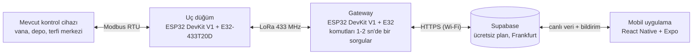

# 09 — Teknoloji ve Donanım Kararları

**LoRaWAN Tabanlı Mobil Su Yönetim Sisteminin Geliştirilmesi** · Karar tarihi: 18.10.2026

Sistem, sahadaki mevcut dijital kontrol cihazlarını ESP32 + E32 LoRa düğümleriyle okuyup yönetir. Veri ESP32 gateway üzerinden Supabase'e gider, React Native (Expo) uygulamasıyla izlenip kontrol edilir. Bu doküman ekip ve danışman görüşlerine göre verilen bütün kararları gerekçeleriyle toplar.

**Danışman yönlendirmesi (Erkan Duman, 18.10.2026):**

- Başlık: "LoRaWAN Tabanlı Mobil Su Yönetim Sisteminin Geliştirilmesi".
- Vanalarda, depolarda ve terfi merkezlerinde dijital kontrol cihazları zaten var. Biz bu cihazlardan LoRa ile veri okuyup yazacağız.
- Görevimiz altyapıyı hazırlamak. İletişim kurulacak cihaz kısmı esnek olacak.

## 1. Özet tablo

| Konu | Karar | Kısa gerekçe |
| --- | --- | --- |
| Uç düğüm kartı | ESP32 DevKit V1 (WROOM-32) | Kod hazır, ucuz, kolay bulunur |
| LoRa modülü | Ebyte E32-433T20D (100 mW) | 10 mW yasal sınıra inebilen tek sürüm |
| Saha cihazı arayüzü | Simüle cihaz + Modbus RTU (RS-485) | Sahada en yaygın protokol, adaptörle esnek |
| Sensör / vana | Alınmayacak | Cihazlar sahada zaten var |
| Uç düğüm beslemesi | USB adaptör | Sahaya özel güç tasarımı yok |
| Gateway | ESP32 + E32-433T20D | Raspberry Pi'den vazgeçildi, tek platform ([ADR-0007](adr/0007-gateway-yeniden-esp32.md)) |
| Gateway interneti | Wi-Fi | Ek donanım yok |
| Sunucu | Supabase ücretsiz plan, Frankfurt | Veri hacmine yeter, en yakın bölge |
| Mobil uygulama | React Native + Expo (TypeScript) | Android ve iOS, Windows'ta geliştirilebilir |
| Mobil dağıtım | Android APK (EAS) + iPhone'da Expo Go | Ücretsiz, iki platformda gösterilebilir |
| Uygulama özellikleri | Grafik, bildirim, roller, eşik ayarları | Hepsi seçildi |
| İş takibi | GitHub Projects + Issues | Kodla aynı yerde, ücretsiz |
| Editör | VS Code (+ PlatformIO) | Tüm parçalar için tek editör |

Oklar iki yönlüdür: ölçüm cihazdan telefona, komut telefondan cihaza aynı yoldan gider.

## 2. Uç düğüm

Her saha noktasında bir ESP32 DevKit V1 ve bir E32-433T20D bulunur. Kart, mevcut kontrol cihazıyla Modbus üzerinden konuşur ve veriyi LoRa ile gateway'e iletir.

**E32-433T20D ayarları:** 433 MHz (kanal 0x17), 2,4 kbps hava hızı, FEC açık, sabit adresli iletim. Güç kademeleri 20 / 17 / 14 / 10 dBm. Kodda "en düşük güç" (3) bu modülde 10 dBm'ye, yani yaklaşık 10 mW'a karşılık gelir. Modül 3,3–5,2 V ile çalışır ve iletimde yaklaşık 130 mA çeker.

| ESP32 pini | Bağlantı | Not |
| --- | --- | --- |
| GPIO16 (RX2) | E32 TXD | |
| GPIO17 (TX2) | E32 RXD | |
| GPIO4 | E32 M0 | Mod seçimi |
| GPIO5 | E32 M1 | Mod seçimi |
| GPIO18 | E32 AUX | LOW = modül meşgul |
| GPIO25 (RX1) | MAX3485 RO | Modbus (sadece `node-modbus`) |
| GPIO26 (TX1) | MAX3485 DI | Modbus |
| GPIO27 | MAX3485 DE + RE | Gönder/al yönü |
| GPIO2 / GPIO34 | LED / potansiyometre | Sadece simüle cihaz |

Adresler: gateway 0x0001, düğümler 0x1001'den başlar. Besleme: USB adaptör (5 V, en az 1 A).

## 3. Saha cihazı arayüzü

Sensör ya da vana satın alınmayacak. Düğüm, sahadaki mevcut kontrol cihazıyla konuşur. Hangi adaptörün kullanılacağı derleme ortamından seçilir ([ADR-0008](adr/0008-saha-cihazi-modbus.md)).

| Adaptör | Ne yapar | PlatformIO ortamı |
| --- | --- | --- |
| SimulatedDevice | LED vanayı, potansiyometre seviyeyi taklit eder | `node`, `node2` |
| ModbusRtuDevice | RS-485 üzerinden Modbus RTU ile register okur ve yazar | `node-modbus` |

- Fiziksel katman: RS-485, 9600 baud, 8N1, MAX3485 modülü (3,3 V).
- Register haritası `firmware/include/modbus_map.h` dosyasındadır. Farklı bir cihaz için sadece bu dosya değişir.
- Test: bilgisayarda ücretsiz bir Modbus slave simülatörü, USB-RS485 çevirici ile MAX3485'e bağlanır.
- Gerçek cihazın register listesi danışmandan ya da cihazın kılavuzundan alınacak.

## 4. Gateway

Gateway bir ESP32 DevKit V1 ve bir E32-433T20D'den oluşur, internete Wi-Fi ile bağlanır.

1. LoRa'dan gelen çerçeveyi doğrular (CRC), tekrarı eler, düğüme onay (ACK) gönderir.
2. Ölçümleri HTTPS ile `telemetry` tablosuna yazar.
3. `commands` tablosundaki bekleyen komutları 1–2 saniyede bir sorgular, düğüme iletir ve durumunu günceller.
4. Kendi durumunu dakikada bir `gateways` tablosuna yazar.

- Komutlar Realtime yerine sorgulama ile alınır; ESP32 için Supabase Realtime kütüphaneleri olgun değil.
- TLS sertifikası doğrulanır: kök sertifikalar (ISRG Root X1/X2, GTS Root R1/R4) koda gömülüdür.
- Wi-Fi ve Supabase bilgileri `firmware/include/secrets.h` dosyasındadır ve GitHub'a yüklenmez.
- Gateway, Supabase'e `gateway` rolü olan normal bir kullanıcıyla girer. `service_role` anahtarı hiçbir cihaza konmaz.

## 5. Sunucu

Supabase ücretsiz planı, Frankfurt (eu-central-1) bölgesi. Türkiye'ye gecikmesi yaklaşık 40–60 ms.

| Kaynak | Ücretsiz plan sınırı | Tahmini kullanım |
| --- | --- | --- |
| Veritabanı | 500 MB | Yılda 50–100 MB (2 düğüm, dakikada bir ölçüm) |
| Proje sayısı | 2 | 1 |
| Etkinlik | 1 hafta kullanılmazsa duraklatılır | Gateway çalıştıkça duraklamaz |

Kullanılan özellikler: PostgreSQL (tablolar, tetikleyiciler), Auth (giriş ve roller), Row Level Security, Realtime, Edge Functions (alarm bildirimi) ve pg_cron (sessiz cihaz kontrolü).

## 6. Mobil uygulama

React Native + Expo + TypeScript. Expo ile sade React Native CLI arasında performans farkı yoktur; ikisi de aynı yerel koda derlenir ve Hermes motorunu kullanır. Expo, Windows'ta geliştirmeye ve Mac olmadan iPhone'da denemeye izin verir.

- Geliştirirken: telefonda Expo Go ile QR kod okutulur.
- Android: EAS Build ücretsiz planıyla APK üretilir (`npm run build:apk`).
- iPhone: Expo Go ile çalışır. Apple geliştirici hesabı ($99/yıl) alınırsa iOS kurulum dosyası da eklenir.
- Uygulama mağazalarda yayınlanmayacak.

| Özellik | Kim kullanır |
| --- | --- |
| Giriş, cihaz listesi, cihaz detayı | Herkes |
| Vana aç/kapat, şimdi oku, periyot ayarı | Operatör, yönetici |
| Geçmiş grafiği (24 saat / 7 gün) | Herkes |
| Alarm listesi ve push bildirimi | Herkes |
| Eşik ayarları | Yönetici |
| Kullanıcı rolleri (yönetici, operatör, izleyici) | Yönetici atar |

Alarm iki durumda açılır: seviye ya da basınç eşiği aşıldığında ve bir cihaz belirlenen süre (varsayılan 10 dakika) sessiz kaldığında. Arayüz metinleri Türkçedir.

## 7. Yazılım dilleri

| Parça | Dil ve araç | Klasör |
| --- | --- | --- |
| Uç düğüm | C++ (Arduino, PlatformIO) | `firmware/src/node` |
| Gateway | C++ (Arduino, PlatformIO) | `firmware/src/gateway` |
| Protokol ve Modbus kütüphaneleri | C++ | `firmware/lib` |
| Veritabanı | SQL (PostgreSQL) | `backend/supabase/migrations` |
| Alarm bildirimi | TypeScript (Supabase Edge Function, Deno) | `backend/supabase/functions` |
| Mobil uygulama | TypeScript (React Native, Expo) | `mobile/` |
| Çerçeve aracı | TypeScript (Node.js) | `tools/` |

Dil kuralı: README Türkçe ve İngilizce, `docs/` Türkçe, kod yorumları ve log mesajları İngilizce, uygulama arayüzü Türkçe ([ADR-0006](adr/0006-bilesen-dilleri.md)). C++ ve TypeScript protokol kodları aynı test vektörlerinden geçer.

## 8. Geliştirme ortamı

Herkes VS Code kullanır. Proje Windows, macOS ve Linux'ta aynı adımlarla çalışır; Windows adımları [05-kurulum.md](05-kurulum.md) içindedir.

İş takibi: GitHub Projects + Issues. `bash scripts/github-issues.sh` aşama issue'larını (A1–A8) ve kanban panosunu oluşturur. Her değişiklik pull request ile gelir, CI yeşil olmadan birleştirilmez.

## 9. Malzeme listesi

Prototip 2 uç düğüm ve 1 gateway'den oluşur, tahmini maliyeti yaklaşık 3.600 TL'dir (Ekim 2026 tahmini fiyatlar). Ayrıntılı liste: [hardware/bom.csv](../hardware/bom.csv).

| Malzeme | Adet | Birim (TL) | Toplam (TL) |
| --- | --- | --- | --- |
| ESP32 DevKit V1 (WROOM-32) | 3 | 250 | 750 |
| Ebyte E32-433T20D | 3 | 350 | 1.050 |
| 433 MHz anten (SMA) | 3 | 80 | 240 |
| MAX3485 RS-485 modülü (3,3 V) | 2 | 50 | 100 |
| USB-RS485 çevirici | 1 | 150 | 150 |
| USB adaptör (5 V, 1 A+) ve kablo | 3 | 150 | 450 |
| Breadboard, jumper, LED, potansiyometre | 1 set | 300 | 300 |
| Yedek (bir ESP32 + bir E32) | 1 | 600 | 600 |
| **Toplam** | | | **~3.640** |

Yazılım tarafında ücretli kalem yok: Supabase, EAS Build, Expo Go ve GitHub ücretsiz planlarla kullanılır.

## 10. Açık konular

- [ ] Ekip üyelerinin adları, rolleri ve GitHub kullanıcı adları (README "Ekip" tablosu)
- [ ] Danışmanın unvanı
- [ ] Supabase projesinin kimin hesabında açılacağı
- [ ] Gerçek kontrol cihazlarının Modbus register listesi
- [ ] 433 MHz'te 10 mW sınırının BTK mevzuatından teyidi
- [ ] Demo için düğüm sayısı (2 mi, 3 mü?)
