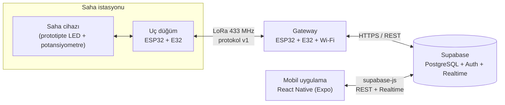

# LoRa Tabanlı Mobil Su Yönetim Sistemi

[](https://github.com/hilllalllk/lora-water-management/actions/workflows/ci.yml)
[](LICENSE)

Su depoları, vanalar ve terfi merkezlerindeki saha cihazlarını **LoRa** ile uzaktan izleyen ve **mobil uygulamadan kontrol eden** bir sistem. Bitirme projesi olarak geliştirilmektedir.

- **Çift yönlü:** Sahadan seviye, vana durumu, basınç, debi ve alarm okunur; uygulamadan vana aç/kapat komutu gönderilir.
- **Cihazdan bağımsız:** Saha cihazı bir adaptör arayüzünün arkasındadır; cihaz değişince sadece adaptör değişir.
- **Güvenilir:** Kendi LoRa protokolümüz CRC, sıra numarası, onay (ACK) ve yeniden gönderim içerir.
- **Test edilmiş:** Protokol, veritabanı yetki kuralları ve mobil uygulama her gönderimde CI ile test edilir.

> **Not:** Proje LoRaWAN ağ sunucusu değil, Ebyte E32 modülleriyle **düz LoRa** kullanır. Gerekçe: [ADR-0001](docs/adr/0001-duz-lora.md).

## Mimari



**Okuma:** düğüm → `TELEMETRY` → gateway → `telemetry` tablosu → tetikleyici `devices`'ı günceller → uygulama canlı görür.
**Yazma:** uygulama `commands`'a `pending` ekler → gateway sorgular → `COMMAND` → düğüm uygular → `CMD_RESULT` → `done`.

Ayrıntılar: [Sistem Mimarisi](docs/02-sistem-mimarisi.md) · [LoRa Protokolü](docs/03-protokol.md)

## Repo yapısı

```
lora-water-management/
├── docs/                  # tüm dokümantasyon (aşağıdaki tabloya bakın)
├── firmware/              # ESP32 (PlatformIO): uç düğüm, gateway, protokol kütüphanesi, testler
├── backend/supabase/      # veritabanı şeması, RLS kuralları, testler
├── mobile/                # React Native (Expo) uygulaması
├── hardware/              # malzeme listesi, devre çizimleri
├── tools/                 # frame_tool.py: LoRa çerçevesi çözücü
└── .github/               # CI, issue ve PR şablonları
```

## Hızlı başlangıç

Adım adım rehber: **[docs/05-kurulum.md](docs/05-kurulum.md)**

```bash
git clone https://github.com/hilllalllk/lora-water-management.git
cd lora-water-management

# 1) Supabase: backend/supabase/migrations/*.sql dosyasını SQL Editor'de çalıştırın
# 2) Firmware
cd firmware && cp include/secrets.example.h include/secrets.h   # bilgileri doldurun
pio test -e native
pio run -e node -t upload
pio run -e gateway -t upload
# 3) Mobil
cd ../mobile && npm install && cp .env.example .env.local && npx expo start
```

## Dokümantasyon

| # | Doküman | İçerik |
|---|---|---|
| 00 | [Proje Özeti](docs/00-proje-ozeti.md) | Amaç ve kapsam |
| 01 | [Mimari Araştırması](docs/01-mimari-arastirmasi.md) | Benzer projeler, LoRa ve LoRaWAN karşılaştırması |
| 02 | [Sistem Mimarisi](docs/02-sistem-mimarisi.md) | Katmanlar, veri modeli, geliştirme aşamaları |
| 03 | [LoRa Protokolü](docs/03-protokol.md) | Bayt düzeyinde tanım ve örnekler |
| 04 | [Donanım](docs/04-donanim.md) | Malzeme listesi, bağlantı şeması, yasal güç uyarısı |
| 05 | [Kurulum Rehberi](docs/05-kurulum.md) | Sıfırdan çalışan sisteme |
| 06 | [Test Planı](docs/06-test-plani.md) | Kabul testleri ve sonuçlar |
| 07 | [Geliştirme Günlüğü](docs/07-gelistirme-gunlugu.md) | İlerleme kaydı |
| 08 | [Güvenlik](docs/08-guvenlik.md) | Korumalar ve bilinen açıklar |
| — | [Mimari Kararlar](docs/adr/README.md) | ADR kayıtları |

## Geliştirme aşamaları

| Aşama | İş | Durum |
|---|---|---|
| — | Araştırma, mimari, protokol tasarımı, repo iskeleti | ✅ |
| A1 | İki ESP32 + E32 ile sabit adresli gönderim | ⬜ |
| A2 | Protokol v1 (CRC, ACK, tekrar) kartta | ⬜ (kod + birim testleri hazır) |
| A3 | Simüle saha cihazı | ⬜ (kod hazır) |
| A4 | Gateway → Supabase | ⬜ (kod hazır) |
| A5 | Supabase → gateway → düğüm komutları | ⬜ (kod hazır) |
| A6 | Mobil uygulama v1 | ⬜ (kod hazır) |
| A7 | Saha / menzil testi | ⬜ |
| A8 | Gerçek cihaz entegrasyonu | ⬜ (danışmana bağlı) |

## Teknolojiler

ESP32 · Ebyte E32-433T30D · C++ / Arduino / PlatformIO · Supabase (PostgreSQL, Auth, Realtime) · React Native / Expo / TypeScript · GitHub Actions

## Ekip

| Ad | Rol |
|---|---|
| Kadir Berke | |
| | |

Danışman: 

## Lisans

[MIT](LICENSE)
