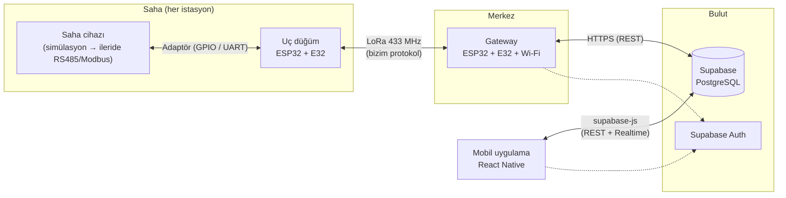
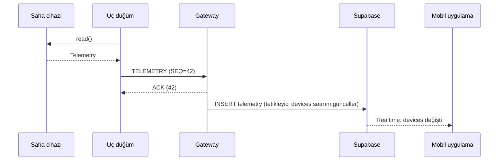
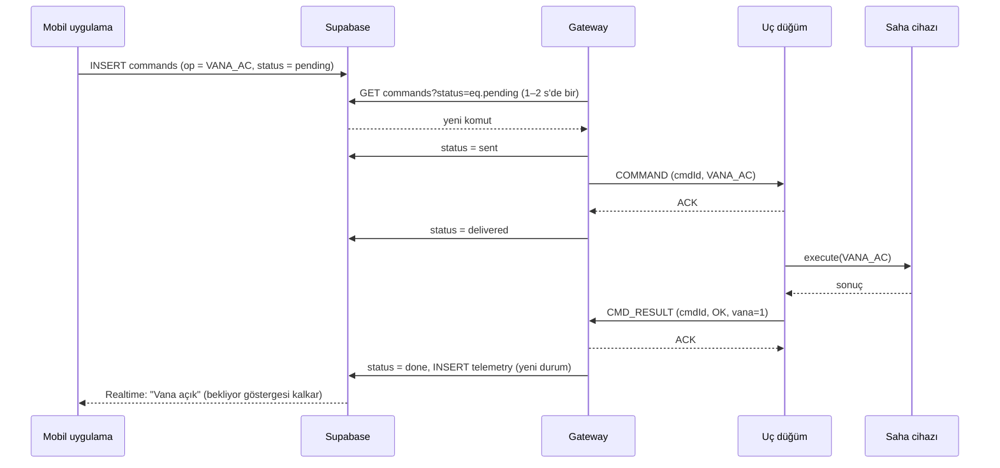

# 02 · Sistem Mimarisi

> Bitirme projesi: **LoRa Tabanlı Mobil Su Yönetim Sistemi**
> Adım 2 çıktısı · 14 Ekim 2026 · Durum: **Taslak v0.2** (Firebase → Supabase)
> Önceki adım: [01 · Mimari Araştırması](01-mimari-arastirmasi.md)

## 0. Alınan kararlar

| # | Karar | Gerekçe |
|---|---|---|
| K1 | Radyo katmanı **düz LoRa**: Ebyte **E32-433T30D**, ağ sunucusu yok | Ekip kararı (14.10.2026); donanım elde, komut sayısında sınır yok |
| K2 | Uç düğüm ve gateway **ESP32** | Wi-Fi dahili, Arduino/PlatformIO desteği geniş |
| K3 | Adresleme, onay (ACK) ve komut protokolü **bizim tarafımızdan** tanımlanır (bkz. §4) | LoRaWAN'ın hazır verdiği işlevleri karşılamak için |
| K4 | Saha cihazı bir **adaptör arayüzü** arkasında soyutlanır | "Cihaz değişse de haberleşme katmanı aynı kalsın" hedefi |
| K5 | Bulut: **Supabase** (PostgreSQL + Auth + Realtime) | Ekip kararı (14.10.2026). İlişkisel tablolar, SQL ile raporlama, Row Level Security ile net yetki kuralları. Ön dokümandaki Firebase yerine |
| K6 | Mobil: **React Native (Expo)** + `supabase-js` | Ön dokümanla aynı arayüz teknolojisi |
| K8 | Gateway komutları **REST ile sorgular** (1–2 s aralıkla); Realtime sonra eklenebilir | ESP32 için resmi Supabase kütüphanesi yok; topluluk kütüphanesi [ESPSupabase](https://github.com/jhagas/ESPSupabase) genç (v0.1.0). Düz HTTPS istekleri en sağlam yol |
| K7 | Düğümler şebeke beslemeli kabul edilir, radyo **sürekli dinlemede** (E32 mod 0) | Vana komutunun gecikmesiz ulaşması için |

---

## 1. Genel görünüm



Tek gateway, birden fazla uç düğüm (yıldız topoloji). Gateway veriyi **yorumlamaz**, sadece LoRa paketini çözüp Supabase'e yazar ve Supabase'deki komutları LoRa paketine çevirir.

---

## 2. Katmanlar ve sorumluluklar

| Katman | Nerede çalışır | Sorumluluk | Bilmediği şey |
|---|---|---|---|
| **Saha cihazı adaptörü** | Uç düğüm | Cihazdan veri okumak, cihaza komut uygulamak | LoRa'yı, Supabase'i |
| **Düğüm uygulaması** | Uç düğüm | Periyodik / olay bazlı telemetri, komutu adaptöre iletmek | Cihazın iç detayı |
| **Bağlantı protokolü** (§4) | Düğüm + gateway | Çerçeveleme, CRC, sıra no, ACK, tekrar deneme | Verinin anlamı |
| **E32 sürücüsü** | Düğüm + gateway | M0/M1/AUX yönetimi, sabit adresli gönderim | Protokolün içeriği |
| **Köprü (bridge)** | Gateway | LoRa ⇄ Supabase dönüşümü, düğüm çevrimiçi takibi | Cihaz türü |
| **Veri katmanı** | Supabase | Son durum, komut kuyruğu, geçmiş, yetki kuralları | Radyo |
| **Mobil uygulama** | Telefon | İzleme, komut verme, komut durumunu gösterme | Radyo, cihaz protokolü |

### 2.1 Saha cihazı adaptörü (cihazdan bağımsızlık)

> Güncel kod: [`firmware/lib/FieldDevice/src/FieldDevice.h`](../firmware/lib/FieldDevice/src/FieldDevice.h). Aşağıdaki örnek tasarım aşamasındaki taslaktır.

Düğüm yazılımı tek bir arayüzle konuşur. Cihaz değiştiğinde sadece yeni bir adaptör yazılır:

```cpp
// firmware/common/FieldDevice.h (taslak)
struct Telemetry {            // TLV olarak kodlanır (§4.4)
  bool     hasLevel;   uint16_t levelMm;
  bool     hasValve;   uint8_t  valveState;   // 0 kapalı, 1 açık, 2 hareket, 3 hata
  bool     hasPressure;uint16_t pressureCbar; // centibar
  bool     hasFlow;    uint16_t flowDlMin;    // desilitre/dk
  uint8_t  alarmFlags;
};

class FieldDevice {
public:
  virtual bool begin() = 0;
  virtual bool read(Telemetry& out) = 0;
  virtual uint8_t execute(uint8_t opcode, const uint8_t* args, uint8_t len) = 0; // sonuç kodu
  virtual ~FieldDevice() {}
};

// Prototip:  SimulatedDevice   → LED = vana, buton/potansiyometre = seviye
// İleride:   ModbusRtuDevice   → RS485 (MAX485) üzerinden gerçek kontrol cihazı
```

---

## 3. Donanım

### 3.1 Bağlantı (uç düğüm ve gateway aynı)

| E32 pini | ESP32 | Not |
|---|---|---|
| VCC | Harici 5 V | Datasheet'e göre gönderimde anlık ~1 A çekebilir; ESP32'nin 3V3 pininden **beslenmemeli** |
| GND | GND | Ortak toprak |
| TXD | GPIO16 (UART2 RX) | |
| RXD | GPIO17 (UART2 TX) | |
| M0 | GPIO4 | Mod seçimi |
| M1 | GPIO5 | Mod seçimi |
| AUX | GPIO18 | Modül meşgul/hazır bilgisi; göndermeden önce HIGH beklenir |

Pin numaraları öneridir, karta göre değişebilir. Prototip saha cihazı: vana için LED (GPIO2), seviye için potansiyometre (GPIO34, ADC).

### 3.2 E32 ayarları

Kaynak: Ebyte E32 kullanım kılavuzu ([PDF](https://atta.szlcsc.com/upload/public/pdf/source/20220808/3C7B3108BF1F7C528E0D6D2B18D3633E.pdf)), [xreef/LoRa_E32_Series_Library](https://github.com/xreef/LoRa_E32_Series_Library).

| Ayar | Değer | Açıklama |
|---|---|---|
| Çalışma modu | Mod 0 (M0=0, M1=0) | Normal gönder/al; mod 3 (M0=1, M1=1) sadece ayar için |
| İletim tipi | **Sabit (fixed)** | Her çerçevenin ilk 3 baytı: ADDH, ADDL, CHAN. Modül bunları havada adres olarak kullanır |
| Kanal | 0x17 → 433 MHz | Frekans = 410 MHz + CHAN × 1 MHz |
| Hava hızı | 2.4 kbps (varsayılan) | İki uç aynı olmalı; menzil/hız testinde değiştirilebilir |
| Paket boyu | ≤ 58 bayt | Modül 58 baytı aşan veriyi böler; protokol çerçevelerimizi **58 baytın altında** tutuyoruz |
| FEC | Açık | |
| Çıkış gücü | **En düşük seviye** (bkz. §8) | |

### 3.3 Adres planı

| Cihaz | ADDH:ADDL | Not |
|---|---|---|
| Gateway | `0x00:0x01` | |
| Uç düğümler | `0x10:0x01` … `0x10:0xFE` | Her düğümün `nodeId` = 16 bit adres |
| Yayın | `0xFF:0xFF` | Tüm düğümlere (ör. zaman eşitleme) |

---

## 4. LoRa bağlantı protokolü (v1)

> Bayt düzeyindeki tam tanım ve örnekler: [03 · LoRa Protokolü](03-protokol.md). Kod: [`firmware/lib/LoraProtocol`](../firmware/lib/LoraProtocol/src/LoraProtocol.h).

LoRaWAN'da hazır gelen kimlik, sıra numarası, onay ve bütünlük kontrolünü küçük bir ikili protokolle karşılıyoruz.

### 4.1 Çerçeve yapısı

```
 E32 sabit başlığı (modül tüketir)     Bizim çerçevemiz (≤ 55 bayt)
┌──────┬──────┬──────┐┌─────┬──────┬────────┬─────┬─────┬───────────────┬────────┐
│ ADDH │ ADDL │ CHAN ││ VER │ TYPE │ SRC(2) │ SEQ │ LEN │ PAYLOAD (≤47) │ CRC16  │
└──────┴──────┴──────┘└─────┴──────┴────────┴─────┴─────┴───────────────┴────────┘
     hedef adres            1      1      2      1     1       LEN          2
```

| Alan | Boyut | Açıklama |
|---|---|---|
| VER | 1 | Protokol sürümü (`0x01`) |
| TYPE | 1 | Mesaj tipi (§4.2) |
| SRC | 2 | Gönderenin adresi (alıcı, cevabı nereye yollayacağını buradan bilir) |
| SEQ | 1 | Gönderen başına artan sıra no (0–255, döner). Tekrar eden paketi ayıklamak için |
| LEN | 1 | PAYLOAD uzunluğu |
| CRC16 | 2 | VER…PAYLOAD üzerinde CRC-16/CCITT-FALSE |

### 4.2 Mesaj tipleri

| TYPE | Ad | Yön | ACK ister mi | İçerik |
|---|---|---|---|---|
| `0x01` | TELEMETRY | Düğüm → GW | Evet | TLV ölçümler (§4.4) |
| `0x02` | HEARTBEAT | Düğüm → GW | Hayır | Çalışma süresi, firmware sürümü |
| `0x10` | COMMAND | GW → Düğüm | Evet | `cmdId(2) · opcode(1) · args` |
| `0x11` | CMD_RESULT | Düğüm → GW | Evet | `cmdId(2) · resultCode(1)` + yeni durum TLV |
| `0x7F` | ACK | İki yön | — | `ackSeq(1)` |

### 4.3 Komut kodları (opcode)

| Opcode | Komut | Argüman |
|---|---|---|
| `0x01` | VANA_AC | — |
| `0x02` | VANA_KAPAT | — |
| `0x03` | CIHAZ_ETKIN | `0/1` |
| `0x04` | SIMDI_OKU | — (anında TELEMETRY gönder) |
| `0x05` | PERIYOT_AYARLA | `saniye(2)` |

Sonuç kodları: `0x00` başarılı, `0x01` bilinmeyen komut, `0x02` cihaz hatası, `0x03` zaman aşımı, `0x04` zaten bu durumda.

### 4.4 Telemetri yükü: TLV (Tag-Length-Value)

Cihaz türü değiştiğinde çerçeve yapısı değişmesin diye ölçümler etiketli gönderilir. Bilinmeyen etiket alıcı tarafından atlanır.

| Tag | Ölçüm | Tip | Birim |
|---|---|---|---|
| `0x01` | Depo seviyesi | uint16 | mm |
| `0x02` | Vana durumu | uint8 | 0 kapalı · 1 açık · 2 hareket · 3 hata |
| `0x03` | Basınç | uint16 | centibar |
| `0x04` | Debi | uint16 | dL/dk |
| `0x05` | Alarm bayrakları | uint8 | bit0 taşma · bit1 kuru çalışma · bit2 sensör hatası |
| `0x06` | Besleme gerilimi | uint16 | mV |

Örnek: seviye 1250 mm, vana açık → `01 02 04E2  02 01 01` (7 bayt).

### 4.5 Güvenilirlik kuralları

- **Dur-ve-bekle ACK:** ACK isteyen bir mesajdan sonra 2 s içinde ACK gelmezse aynı SEQ ile tekrar gönderilir; en fazla 3 deneme. (2 s başlangıç değeridir, 2.4 kbps'de ölçülen gidiş-dönüş süresine göre ayarlanacak.)
- **Tekrar ayıklama:** Alıcı her gönderen için son SEQ'i saklar; aynı SEQ tekrar gelirse yeniden ACK gönderir ama işlemi **tekrarlamaz**.
- **Komutlar tekrar uygulanabilir (idempotent):** `cmdId` aynıysa düğüm komutu ikinci kez çalıştırmaz, önceki sonucu yeniden gönderir.
- **Çakışmayı azaltma:** Düğümler periyodik telemetriyi `periyot ± rastgele %20` sapmayla gönderir. Gönderimden önce AUX pininin HIGH olması beklenir.
- **Olay bazlı gönderim:** Vana durumu değişirse veya alarm oluşursa periyot beklenmeden TELEMETRY gönderilir.
- **Güvenlik (v2'ye bırakıldı):** E32 kılavuzunda şifreleme özelliği tanımlı değil, yani radyo trafiği düz metin. v2'de yüke AES-128 şifreleme ve 4 baytlık doğrulama etiketi (MIC) eklenebilir; çerçeve ≤ 58 bayt sınırında kalacak şekilde PAYLOAD sınırı buna göre düşürülür. Prototip için bu bilinçli bir kısıt olarak raporlanmalı.

### 4.6 Akışlar

**Okuma (saha → mobil)**



**Yazma (mobil → saha)**



Uygulama komut gönderince butonu **"bekliyor"** durumunda tutar ve gerçek durumu ancak düğüm `CMD_RESULT` gönderdikten sonra gösterir. 3 denemede ACK alınamazsa gateway `status = failed` yazar.

---

## 5. Gateway yazılımı

Görevleri:

1. **LoRa alıcı döngüsü:** Çerçeveyi oku → CRC kontrol → tekrar ayıklama → ACK gönder → Supabase'e `telemetry` satırı ekle.
2. **Komut sorgulayıcı:** 1–2 s'de bir `status = pending` komutları REST ile çek → LoRa'ya çevir → durumunu güncelle.
3. **Çevrimiçi takip:** `devices.last_seen` her pakette güncellenir; uygulama `now() - last_seen > 3 × periyot` ise cihazı çevrimdışı gösterir (ayrı bir alan tutmaya gerek yok).
4. **Kendi sağlığı:** `gateways.last_seen` her 60 s güncellenir; Wi-Fi koparsa yeniden bağlanır. v1'de bu sırada gelen telemetri buluta yazılamaz ve kaybolur (düğüme yine ACK verilir); kalıcı kuyruk v2'ye bırakıldı.

Kütüphaneler: `xreef/LoRa_E32_Series_Library` (E32), Supabase için ESP32'nin kendi `HTTPClient` + `WiFiClientSecure` ile doğrudan REST (PostgREST) çağrıları, JSON için `ArduinoJson`. Realtime gerekirse [ESPSupabase](https://github.com/jhagas/ESPSupabase) denenebilir. Sürümler adım 3'te sabitlenecek.

---

## 6. Supabase veri modeli

> Güncel ve çalışan şema: [`backend/supabase/migrations/20261014000000_init.sql`](../backend/supabase/migrations/20261014000000_init.sql). Bu bölüm tasarım özetidir; farklılık olursa migration dosyası geçerlidir.

Tam şema repoda `backend/supabase/migrations/` altında SQL dosyası olarak tutulacak (adım 3). Taslak:

```sql
-- Cihazlar ve son durumları
create table devices (
  id            text primary key,              -- ör. 'node-1001'
  address       integer not null unique,        -- LoRa adresi, ör. 0x1001
  name          text not null,
  type          text not null default 'tank+valve',
  fw            text,
  period_s      integer not null default 60,
  level_mm      integer,
  valve         smallint,                       -- 0 kapalı · 1 açık · 2 hareket · 3 hata
  pressure_cbar integer,
  flow_dl_min   integer,
  alarms        smallint not null default 0,
  last_seen     timestamptz
);

-- Ölçüm geçmişi (her TELEMETRY / CMD_RESULT bir satır)
create table telemetry (
  id            bigint generated always as identity primary key,
  device_id     text not null references devices(id),
  received_at   timestamptz not null default now(),
  level_mm      integer,
  valve         smallint,
  pressure_cbar integer,
  flow_dl_min   integer,
  alarms        smallint
);
create index on telemetry (device_id, received_at desc);

-- Komut kuyruğu
create type command_status as enum ('pending','sent','delivered','done','failed');
create table commands (
  id          bigint generated always as identity primary key,  -- LoRa'da cmdId (alt 16 bit)
  device_id   text not null references devices(id),
  op          text not null check (op in ('VANA_AC','VANA_KAPAT','CIHAZ_ETKIN','SIMDI_OKU','PERIYOT_AYARLA')),
  args        jsonb,
  status      command_status not null default 'pending',
  result      smallint,
  created_by  uuid not null default auth.uid() references auth.users(id),
  created_at  timestamptz not null default now(),
  updated_at  timestamptz not null default now()
);

-- Gateway sağlığı
create table gateways (
  id         text primary key,
  fw         text,
  wifi_rssi  integer,
  last_seen  timestamptz
);

-- Yeni telemetri gelince cihazın son durumunu güncelleyen tetikleyici
create function apply_telemetry() returns trigger
  language plpgsql security definer set search_path = public as $$
begin
  update devices set
    level_mm      = coalesce(new.level_mm, level_mm),
    valve         = coalesce(new.valve, valve),
    pressure_cbar = coalesce(new.pressure_cbar, pressure_cbar),
    flow_dl_min   = coalesce(new.flow_dl_min, flow_dl_min),
    alarms        = coalesce(new.alarms, alarms),
    last_seen     = new.received_at
  where id = new.device_id;
  return new;
end $$;
create trigger telemetry_apply after insert on telemetry
  for each row execute function apply_telemetry();
```

Mobil uygulama `devices` ve `commands` tablolarına **Realtime** ile abone olur (bu tablolar `supabase_realtime` yayınına eklenir).

### 6.1 Yetki kuralları (Row Level Security)

Gateway, Supabase Auth'ta kendine ait bir kullanıcıyla giriş yapar. Bu kullanıcının `app_metadata` alanına yönetici panelinden `{"role": "gateway"}` yazılır (bu alanı kullanıcı kendisi değiştiremez). **`service_role` anahtarı cihaza asla konmaz**; o anahtar tüm RLS kurallarını atlar.

| Tablo | Okuma | Ekleme | Güncelleme |
|---|---|---|---|
| `devices` | Giriş yapmış herkes | Yönetici (panelden) | Tetikleyici üzerinden (gateway telemetri ekleyince) |
| `telemetry` | Giriş yapmış herkes | Sadece gateway | Kimse |
| `commands` | Giriş yapmış herkes | Giriş yapmış kullanıcı, sadece `status = 'pending'` ile | Sadece gateway |
| `gateways` | Giriş yapmış herkes | — | Sadece gateway |

```sql
alter table telemetry enable row level security;
create policy "okuma" on telemetry for select to authenticated using (true);
create policy "gateway yazar" on telemetry for insert to authenticated
  with check ((auth.jwt() -> 'app_metadata' ->> 'role') = 'gateway');

alter table commands enable row level security;
create policy "okuma" on commands for select to authenticated using (true);
create policy "kullanici komut ekler" on commands for insert to authenticated
  with check (status = 'pending' and created_by = auth.uid());
create policy "gateway durum gunceller" on commands for update to authenticated
  using ((auth.jwt() -> 'app_metadata' ->> 'role') = 'gateway');
-- devices ve gateways için benzer kurallar
```

Gateway'in e-posta/şifresi ve Supabase proje URL'si + `anon` anahtarı repoda değil `secrets.h` dosyasında tutulur (repoya `secrets.example.h` konur).

### 6.2 Gateway'in kullandığı REST çağrıları

| Amaç | İstek |
|---|---|
| Giriş (token alma) | `POST /auth/v1/token?grant_type=password` |
| Telemetri ekleme | `POST /rest/v1/telemetry` |
| Bekleyen komutları çekme | `GET /rest/v1/commands?status=eq.pending&order=id.asc` |
| Komut durumu güncelleme | `PATCH /rest/v1/commands?id=eq.{id}` |
| Gateway sağlığı | `PATCH /rest/v1/gateways?id=eq.{gw}` |

Her istekte `apikey: <anon>` ve `Authorization: Bearer <access_token>` başlıkları gönderilir; token süresi dolunca `grant_type=refresh_token` ile yenilenir.

---

## 7. Mobil uygulama (v1 kapsamı)

| Ekran | İçerik |
|---|---|
| Giriş | Supabase Auth (e-posta/şifre) |
| Cihaz listesi | Ad, çevrimiçi/çevrimdışı, son veri zamanı, alarm rozeti |
| Cihaz detayı | Seviye, vana durumu, basınç, debi; vana aç/kapat butonları (bekliyor göstergeli); son komut ve sonucu |
| Geçmiş (v2) | `telemetry` tablosundan grafik |
| Alarmlar (v2) | Alarm bayrakları için bildirim |

---

## 8. Kısıtlar ve riskler

| Risk | Etki | Önlem |
|---|---|---|
| **Yasal çıkış gücü.** E32-433T30D yaklaşık 1 W sınıfında bir modül; Avrupa (CEPT) kurallarında 433.05–434.79 MHz kısa mesafe cihaz bandında izin verilen güç bunun çok altında (çoğunlukla 10 mW e.r.p. düzeyinde, görev döngüsü sınırıyla). Türkiye için geçerli değer **BTK düzenlemesinden doğrulanmalı** (bu not çıkarımdır). | Sahada yasal olmayan yayın | Testlerde en düşük güç seviyesi, kısa anten mesafesi; raporda konu açıkça belirtilir; danışmana sorulur |
| Başlıkta "LoRaWAN" geçmesi | Jüri sorusu | Raporda "LoRaWAN yerine LoRa tercih edilme gerekçesi" bölümü; başlık danışmanla teyit |
| Şifreleme yok | Komut dinlenebilir/taklit edilebilir | v2'de AES + MIC (§4.5); prototipte kısıt olarak raporlanır |
| Tek kanal, çakışma | Paket kaybı | ACK + tekrar + rastgele sapma; düğüm sayısı az |
| Gateway tek nokta | Gateway düşerse sistem durur | `gateways.last_seen` ile uygulamada uyarı |
| Supabase ücretsiz plan | 500 MB sınır, 1 hafta hareketsizlikte duraklatma | Gateway sürekli yazdığı için aktif kalması beklenir (çıkarım); eski telemetri periyodik silinir/özetlenir |
| E32 RSSI bilgisi | Kılavuzda RSSI okuması tanımlı değil | Bağlantı kalitesi ACK başarı oranıyla ölçülür |

---

## 9. Geliştirme aşamaları ve kabul kriterleri

| Aşama | İş | Bitti sayılması için |
|---|---|---|
| A1 | İki ESP32 + E32 ile sabit adresli gönderim | 100 paketten ≥ 95'i ulaşıyor (masa testi) |
| A2 | Protokol v1: çerçeve, CRC, ACK, tekrar | Gönderici kapatılıp açılsa da tekrar eden paket işlenmiyor |
| A3 | SimulatedDevice: LED vana + potansiyometre seviye | Seri monitörde TLV doğru çözülüyor |
| A4 | Gateway → Supabase köprüsü | Seviye değişimi 5 s içinde Supabase tablosunda |
| A5 | Supabase → gateway → düğüm komut akışı | Tabloya eklenen VANA_AC ile LED yanıyor, `status = done` |
| A6 | React Native uygulama v1 | Uygulamadan vana aç/kapat, durum anlık güncelleniyor |
| A7 | Saha testi | Farklı mesafelerde ACK başarı oranı ve gecikme ölçülüp rapora tablo olarak ekleniyor |
| A8 | Gerçek cihaz adaptörü (danışmana bağlı) | ModbusRtuDevice ile en az bir register okunuyor / yazılıyor |

---

## 10. Danışmana sorulacaklar

1. Proje başlığındaki "LoRaWAN" ifadesi "LoRa" olarak güncellenebilir mi?
2. E32-433T30D'nin çıkış gücü konusunda okulun/laboratuvarın bir yönergesi var mı?
3. Gerçek saha cihazı hangi arayüzle bağlanacak (RS485/Modbus RTU, 4–20 mA, röle)?
