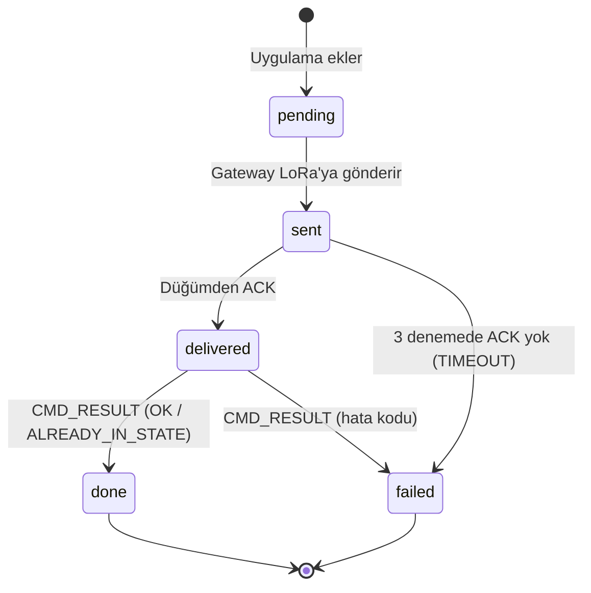

# 03 · LoRa Bağlantı Protokolü (v1)

> Uygulama: [`firmware/lib/LoraProtocol`](../firmware/lib/LoraProtocol/src/LoraProtocol.h) (C++) ve [`tools/frame_tool.py`](../tools/frame_tool.py) (Python, hata ayıklama için).
> Testler: [`firmware/test/test_protocol`](../firmware/test/test_protocol/test_main.cpp), [`tools/test_frame_tool.py`](../tools/test_frame_tool.py).
> Bu dokümandaki tüm örnek baytlar `frame_tool.py` ile üretildi ve C++ testleriyle aynı sonucu verir.

## 1. Neden kendi protokolümüz?

Proje LoRaWAN yerine düz LoRa (Ebyte E32) kullanıyor ([ADR-0001](adr/0001-duz-lora.md)). E32 modülü sadece "şu adrese şu baytları gönder" hizmeti verir. LoRaWAN'ın hazır sunduğu şu işlevleri bu protokol karşılar:

| İhtiyaç | LoRaWAN'da | Bizim protokolde |
|---|---|---|
| Gönderenin kimliği | DevAddr | `SRC` alanı (16 bit) |
| Bozuk paketi ayırt etme | MIC | `CRC16` |
| Tekrar eden paketi ayıklama | Frame counter | `SEQ` + `DuplicateFilter` |
| Teslim garantisi | Confirmed uplink/downlink | ACK + en fazla 3 deneme |
| Cihazdan bağımsız veri | Payload codec | TLV telemetri |
| Şifreleme | AES-128 | **Yok (v2'ye bırakıldı)**, bkz. [08 · Güvenlik](08-guvenlik.md) |

## 2. Taşıma katmanı: E32 sabit adresli iletim

E32 modülü "fixed transmission" modunda yapılandırılır. Gönderici UART'a şunu yazar:

```
ADDH  ADDL  CHAN  | çerçeve baytları (≤ 55)
```

Modül ilk 3 baytı hedef adres ve kanal olarak kullanır, havaya sadece çerçeveyi gönderir. Alıcı modül, adresi kendisininkiyle eşleşirse çerçeveyi UART'tan verir. E32 tek radyo paketinde en fazla **58 bayt** taşır; bu yüzden çerçeve en fazla 55 bayttır ve hiçbir zaman bölünmez.

| Adres | Kullanım |
|---|---|
| `0x0001` | Gateway |
| `0x1001` – `0x10FE` | Uç düğümler |
| `0xFFFF` | Yayın (v1'de kullanılmıyor) |

## 3. Çerçeve yapısı

```
 0      1      2      3      4      5      6 ..         6+LEN  7+LEN
┌──────┬──────┬─────────────┬──────┬──────┬────────────┬─────────────┐
│ VER  │ TYPE │  SRC (BE)   │ SEQ  │ LEN  │  PAYLOAD   │  CRC16 (BE) │
└──────┴──────┴─────────────┴──────┴──────┴────────────┴─────────────┘
   1      1         2          1      1      0..47           2
```

- Çok baytlı alanlar **big-endian** (önce yüksek bayt).
- `VER` = `0x01`. Farklı sürüm reddedilir.
- `CRC16` = CRC-16/CCITT-FALSE (polinom `0x1021`, başlangıç `0xFFFF`), `VER`'den `PAYLOAD` sonuna kadar hesaplanır. Kontrol değeri: `"123456789"` → `0x29B1`.
- Toplam uzunluk = `8 + LEN`, en fazla 55 bayt.

### 3.1 UART akışından çerçeve ayırma

E32 bir paketi UART'a ardışık baytlar olarak verir. `FrameAssembler`:

1. `VER` (0x01) görene kadar baytları atar.
2. 6. baytta `LEN`'i okur, `8 + LEN` bayt toplayınca çerçeveyi tamamlar.
3. İki bayt arasında **50 ms**'den uzun boşluk olursa yarım çerçeveyi atar (yeniden senkronizasyon).
4. Tamamlanan çerçeve `decodeFrame` ile CRC kontrolünden geçer.

## 4. Mesaj tipleri

| TYPE | Ad | Yön | ACK | PAYLOAD |
|---|---|---|---|---|
| `0x01` | TELEMETRY | Düğüm → GW | Evet | TLV ölçümler (§5) |
| `0x02` | HEARTBEAT | Düğüm → GW | Hayır | `uptime_s (4)` + firmware sürümü (ASCII) |
| `0x10` | COMMAND | GW → Düğüm | Evet | `cmdId (2)` · `opcode (1)` · `args (0..8)` |
| `0x11` | CMD_RESULT | Düğüm → GW | Evet | `cmdId (2)` · `result (1)` · durum TLV |
| `0x7F` | ACK | İki yön | — | `ackSeq (1)` |

### 4.1 Komutlar

| Opcode | Veritabanında `op` | Argüman | Açıklama |
|---|---|---|---|
| `0x01` | `VANA_AC` | — | Vanayı aç |
| `0x02` | `VANA_KAPAT` | — | Vanayı kapat |
| `0x03` | `CIHAZ_ETKIN` | `0/1` (1 bayt) | Cihazı devre dışı bırak / etkinleştir. Devre dışıyken vana komutları `DEVICE_ERROR` döner |
| `0x04` | `SIMDI_OKU` | — | Periyodu beklemeden TELEMETRY gönder |
| `0x05` | `PERIYOT_AYARLA` | `saniye (2)` | Telemetri periyodu, en az 10 s |

`cmdId`, veritabanındaki `commands.id` değerinin alt 16 bitidir.

### 4.2 Sonuç kodları

| Kod | Ad | Gateway'in yazdığı durum |
|---|---|---|
| `0x00` | OK | `done` |
| `0x01` | UNKNOWN_COMMAND | `failed` |
| `0x02` | DEVICE_ERROR | `failed` |
| `0x03` | TIMEOUT (gateway üretir: 3 denemede ACK yok) | `failed` |
| `0x04` | ALREADY_IN_STATE | `done` |

## 5. Telemetri: TLV

Her ölçüm `etiket (1) · uzunluk (1) · değer` olarak yazılır. Alıcı **bilmediği etiketi atlar**; böylece yeni bir sensör eklemek eski gateway'i bozmaz.

| Etiket | Ölçüm | Boyut | Birim / anlam | Veritabanı sütunu |
|---|---|---|---|---|
| `0x01` | Depo seviyesi | 2 | mm | `level_mm` |
| `0x02` | Vana durumu | 1 | 0 kapalı · 1 açık · 2 hareket · 3 hata | `valve` |
| `0x03` | Basınç | 2 | centibar (1 bar = 100) | `pressure_cbar` |
| `0x04` | Debi | 2 | desilitre/dakika | `flow_dl_min` |
| `0x05` | Alarm bayrakları | 1 | bit0 taşma · bit1 kuru çalışma · bit2 sensör hatası | `alarms` |
| `0x06` | Besleme gerilimi | 2 | mV | (v1'de saklanmıyor) |

## 6. Güvenilirlik kuralları

**Gönderen (`ReliableSender`):**
- ACK isteyen bir çerçeve gönderildikten sonra **2 s** içinde aynı `SEQ` için ACK beklenir.
- Gelmezse aynı baytlar yeniden gönderilir; toplam **3 deneme**.
- Dur-ve-bekle: bir mesaj ACK beklerken yenisi gönderilmez. Düğümde öncelik sırası: CMD_RESULT → TELEMETRY → HEARTBEAT.
- `SEQ` her çerçevede 1 artar (ACK'ler dahil), açılışta rastgele başlar.

**Alıcı:**
- ACK isteyen her çerçeveye, tekrar olsa bile, hemen ACK gönderir.
- `DuplicateFilter`: gönderen başına son `SEQ` saklanır. Aynı `SEQ` gelirse ACK verilir ama **işlenmez**.
- Düğüm son 4 komutun sonucunu saklar. Aynı `cmdId` tekrar gelirse komutu **yeniden uygulamaz**, eski sonucu tekrar gönderir.

**Çakışmayı azaltma:**
- Periyodik telemetri `periyot ± %20` rastgele sapmayla gönderilir.
- Göndermeden önce E32'nin `AUX` pininin HIGH (boşta) olması beklenir.
- Vana durumu veya alarm değişince periyot beklenmeden gönderilir.

## 7. Örnek konuşma (bayt bayt)

Senaryo: düğüm `0x1001` seviye 1250 mm ve vana açık bilgisini gönderir, sonra kullanıcı uygulamadan `VANA_AC` (veritabanı id 15) gönderir.

| # | Yön | Baytlar (E32 başlığı hariç) | Anlam |
|---|---|---|---|
| 1 | Düğüm → GW | `01 01 10 01 2A 07 01 02 04 E2 02 01 01 45 CB` | TELEMETRY, SRC 0x1001, SEQ 42, seviye 1250, vana 1 |
| 2 | GW → Düğüm | `01 7F 00 01 C8 01 2A 86 CB` | ACK, SRC 0x0001, SEQ 200, ackSeq 42 |
| 3 | GW → Düğüm | `01 10 00 01 C9 03 00 0F 01 8B 42` | COMMAND, SEQ 201, cmdId 15, opcode VANA_AC |
| 4 | Düğüm → GW | `01 7F 10 01 2B 01 C9 B6 BD` | ACK, ackSeq 201 → veritabanında `delivered` |
| 5 | Düğüm → GW | `01 11 10 01 2C 06 00 0F 00 02 01 01 96 3E` | CMD_RESULT, cmdId 15, OK, vana 1 → `done` |
| 6 | GW → Düğüm | `01 7F 00 01 CA 01 2C …` | ACK, ackSeq 44 |
| 7 | Düğüm → GW | `01 02 10 01 2D 09 00 00 0E 10 30 2E 31 2E 30 F7 11` | HEARTBEAT, çalışma 3600 s, fw "0.1.0" |

Kendiniz denemek için:

```bash
python3 tools/frame_tool.py decode "01 11 10 01 2C 06 00 0F 00 02 01 01 96 3E"
# {'type': 'CMD_RESULT', 'src': '0x1001', 'seq': 44, 'cmd_id': 15, 'result': 'OK', 'state': {'valve': 1}}
```

## 8. Komut durum makinesi (veritabanı)



## 9. Sürümleme

- Çerçeve yapısı değişirse `VER` artırılır; eski sürüm çerçeveleri reddedilir.
- Yeni ölçüm eklemek **sürüm değişikliği gerektirmez** (yeni TLV etiketi yeterli).
- Yeni komut eklemek için: opcode tablosu (§4.1), `Opcode` enum'u, `commands.op` CHECK kısıtı, gateway'deki `opFromText` ve mobil `CommandOp` tipi birlikte güncellenir.

## 10. Bilinen kısıtlar (v1)

- Şifreleme ve kimlik doğrulama yok: radyo trafiği dinlenebilir ve taklit edilebilir ([08 · Güvenlik](08-guvenlik.md)).
- Gateway tek seferde tek komut gönderir (dur-ve-bekle). Az sayıda düğüm için yeterli.
- E32 kılavuzunda RSSI okuması tanımlı değil; bağlantı kalitesi ACK başarı oranıyla ölçülür ([06 · Test Planı](06-test-plani.md)).
